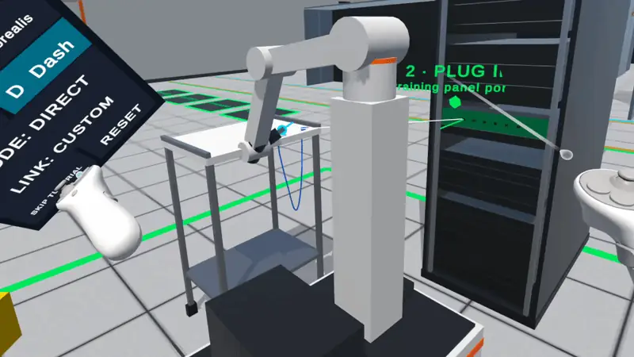

# Data Center Robot Teleoperation

I built this to find out what it's like to remote control robots inside a data center. The user can drive a
mobile robot arm up to a rack, pick a cable off a cart and plug it into the right port. It runs on a Meta Quest on its own (no PC
needed once it's installed) and in a web browser.



*On the Quest: carrying a cable over to the training panel.*

You can try the browser version at [mzaidk.com/droyd](https://mzaidk.com/droyd). The full write-up,
with the architecture, every control, the tests and performance numbers, is in
[README_DataCenter.md](README_DataCenter.md).

## Running it on a Quest

You'll need:

- a Meta Quest 2, 3, 3S or Pro
- Unity 6000.4.0f1 with Android Build Support (including OpenJDK and the Android SDK & NDK Tools)
- a USB-C cable that carries data, not just charge
- the Meta Horizon app on your phone, signed in with the same account as the headset

### 1. Get the project into Unity

Clone the repo:

```bash
git clone https://github.com/ZaidKamil1574/Robot-Teleoperation.git
```

Or grab it as a ZIP from the green **Code** button and unzip it.

If you don't have Unity Hub yet, [install it first](https://docs.unity.com/en-us/hub/install-hub).
Then in Hub choose **Add > Add project from disk**, point it at the `Robot-Teleoperation` folder and
open it with Unity 6000.4.0f1.

 Add project from disk" width="800">

Hub may say Android support is missing. If it does, go to **Installs**, click the gear next to
6000.4.0f1, choose **Add modules** and tick Android Build Support along with OpenJDK and Android SDK
& NDK Tools. Once they're installed it looks like this:


The first time the project opens, Unity has to import everything, so give it a few minutes. When
it's done you should see the data center:


If you get an empty scene instead, go to `Assets/DataCenter/Scenes` in the Project window and
double-click **DataCenter**.

### 2. Turn on developer mode (one time only)

On your phone, open the Meta Horizon app and go to **Menu > Devices**, pick your headset, then
**Headset settings > Developer mode** and switch it on. It may ask you to create a developer
organization at [developers.meta.com](https://developers.meta.com/horizon/) first. That's free and
only takes a minute.

Restart the headset, plug it into your computer, put it on and accept the "Allow USB debugging"
prompt. Tick "Always allow from this computer" so it doesn't ask again.

### 3. Build it to the headset

In Unity, open **File > Build Profiles**, select **Android** and click **Switch Platform**. You only
need to do this once, but the first time takes a few minutes.

Then, with the headset plugged in and awake, go to **Tools > Data Center > Platforms > Build And
Run on Quest**.

 Data Center > Platforms menu" width="650">

This builds just the data center scene, installs it as DC Teleop and launches it on the headset.
The first build takes around 10 minutes; after that it's much quicker. Next time you can start it
straight from the headset under **Library > Unknown Sources > DC Teleop**.

While it's running, the Android Logcat window streams the app's log from the headset. If it
doesn't open by itself, you'll find it under **Window > Analysis > Android Logcat**. Every line has
a timestamp and the app's process ID.


Mostly white lines means everything's fine, and a few yellow warnings at start-up are normal. Red
lines are errors. If you see those, or the log stops and the app quits, have a look at the notes at
the bottom of this page.

There's no need to touch any XR settings; OpenXR with Meta Quest support is already set up.

If you'd rather have an APK to install later, use **Build Quest APK** in the same menu. It saves
`Builds/Quest/DataCenterTeleop.apk`, which you can drag onto the headset in
[Meta Quest Developer Hub](https://developers.meta.com/horizon/documentation/unity/ts-mqdh/) or
install from a terminal:

```bash
adb install -r Builds/Quest/DataCenterTeleop.apk
```

## Playing

Follow the floating marker and the NEXT instructions on the dashboard. The robot only moves while
you're holding a control, and stops as soon as you let go.

| Quest controller | What it does |
|---|---|
| Left stick | Drive the robot (it can slide sideways too) |
| A / B | Turn clockwise / anticlockwise |
| Right stick | Move the gripper (click the stick in and push to reach forward or back) |
| R2 + right stick | Rotate the wrist |
| L2 (hold) | Grab a cable. Bring it close to the target port and it plugs itself in |
| Right grip + right stick | Teleport and turn |
| X | Emergency stop. Let go of everything and press X again to reset |
| Y | Show or hide the dashboard |

The controllers buzz faster the closer the gripper gets to a cable, or a cable gets to its port.
You'll hear a chime when you can grab and another when the plug lines up. A thud and a buzz means
you've hit a rack; the robot can't drive or reach through equipment.

Playing in the browser instead? The keyboard controls are in
[README_DataCenter.md](README_DataCenter.md#controls). There's also an **AUTO DEMO** button in the
top bar if you'd like to watch each robot do a job on its own first. Press any key to take over.

## If something goes wrong

- **Unity asks you to switch to Android.** Do the Build Profiles step in section 3 first.
- **The headset isn't detected.** Put it on and accept the USB debugging prompt. If that doesn't
  help, try another cable or port; some cables only charge.
- **You press Play and nothing shows up in the headset.** Playing from the Editor needs Quest
  Link, which only runs on Windows. On a Mac, use Build And Run on Quest instead.
- **The app closes right after it starts.** Build from the Tools > Data Center menu rather than
  Unity's own Build And Run. The menu builds only the data center scene and clears out leftovers
  from other scenes.
- **Red errors in Logcat.** The first red line, and the one just before it, usually tell you what
  went wrong.
- **Hub can't find Unity 6000.4.0f1.** It's in the
  [Unity download archive](https://unity.com/releases/editor/archive). Add Android Build Support
  when you install it.
