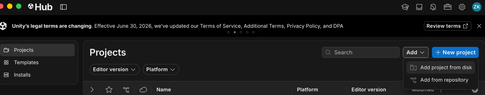
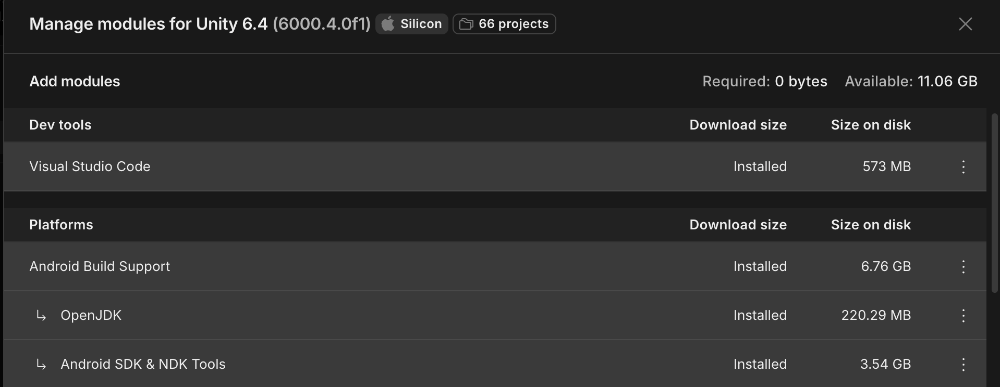
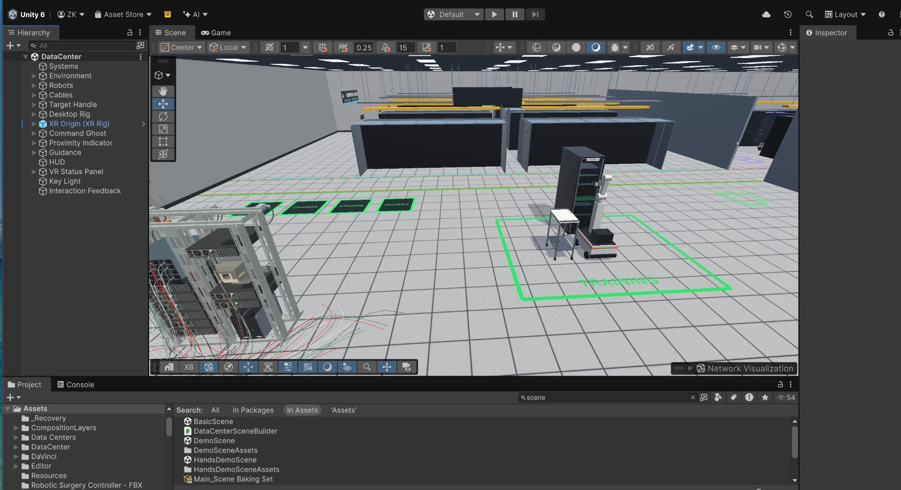
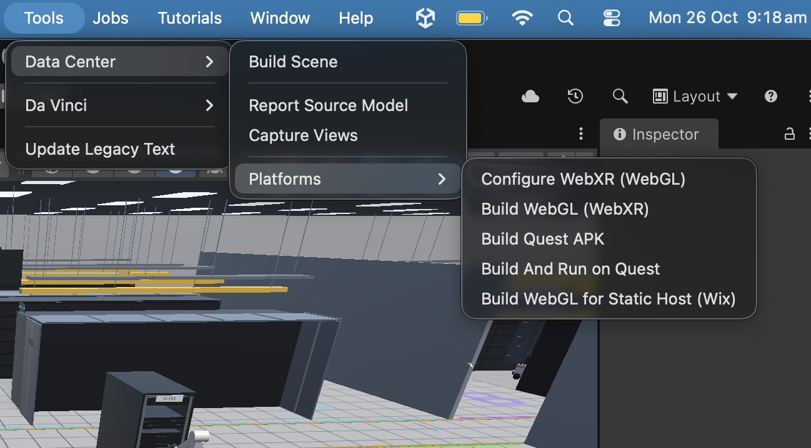
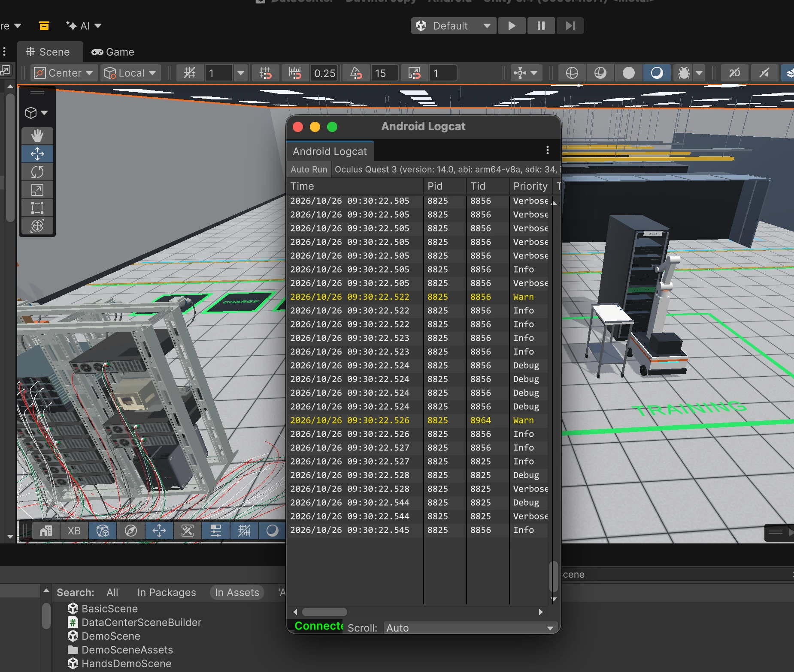

# Data Center Teleoperation Simulator (Unity 6 · Meta Quest · WebGL)

An XR data center simulation: drive robots around a data center and complete cabling work orders
step by step. Pick up a cable, carry it to the right rack and plug it into the right port. The
application runs **on a Meta Quest** and **in the browser**.

- **In the browser (WebGL):** [mzaidk.com/droyd](https://mzaidk.com/droyd)
- **Full documentation** (architecture, all controls, tests, performance): [README_DataCenter.md](README_DataCenter.md)

---

## Steps to build it for a Meta Quest headset

### What you need

| | |
|---|---|
| Headset | Meta Quest 2, 3, 3S or Pro |
| Unity | **6000.4.0f1** with **Android Build Support** (and its OpenJDK and Android SDK & NDK Tools) |
| Cable | A USB-C data cable from the computer to the headset |
| Phone | The **Meta Horizon** app, signed in to the account the headset uses |

### 1. Get the project and open it in Unity

1. Clone the repository:

   ```bash
   git clone https://github.com/ZaidKamil1574/Robot-Teleoperation.git
   ```

   Or download it instead: on this page click the green **Code** button, then **Download ZIP**,
   and unzip it.

2. Install Unity Hub if you don't have it: [Install the Unity Hub](https://docs.unity.com/en-us/hub/install-hub).

3. In **Unity Hub**, click **Add > Add project from disk**, pick the `Robot-Teleoperation` folder
   and open it with Unity **6000.4.0f1**.

    Add project from disk" width="800">

4. If Hub says Android support is missing: **Installs > 6000.4.0f1 > gear icon > Add modules >
   Android Build Support**, and tick **OpenJDK** and **Android SDK & NDK Tools** too. When they are
   installed, the list looks like this:

   

5. Unity opens the project. The first time, it imports everything, which takes a while. When it is
   done it looks like this:

   

   If you see an empty scene instead, open the data center: in the **Project** window go to
   `Assets/DataCenter/Scenes` and double-click **DataCenter**.

### 2. Put the headset in developer mode (once)

1. In the **Meta Horizon** app: **Menu > Devices >** your headset **> Headset settings > Developer
   mode**, and switch it on. If it asks you to, create a free developer organization at
   [developers.meta.com](https://developers.meta.com/horizon/) first.
2. Restart the headset.
3. Plug the headset into the computer, put it on and accept **Allow USB debugging** (tick
   **Always allow from this computer**).

### 3. Build and install

1. In Unity: **File > Build Profiles > Android > Switch Platform**. Only needed once; it takes a
   few minutes the first time.
2. With the headset plugged in and awake: **Tools > Data Center > Platforms > Build And Run on
   Quest**.

    Data Center > Platforms menu with Build And Run on Quest" width="650">

   This builds only the data center scene, installs it on the headset as **DC Teleop** and starts
   it. The first build takes about 10 minutes; later ones are faster.

3. When the build starts on the headset, the **Android Logcat** window shows the app's log, with
   a timestamp and process id (PID) on every line. If it does not open by itself, use **Window >
   Analysis > Android Logcat**.

   

   White lines are normal output, so a steady stream of white means the app is running fine. A few
   yellow warnings at start-up are normal too. Red lines are errors: if you see them, or the log
   stops and the app closes, check [If something goes wrong](#if-something-goes-wrong).

To start the app again later, on the headset: **Library > Unknown Sources > DC Teleop**.

The XR settings (OpenXR with Meta Quest support) are already set up in the project; there is
nothing to change.

#### Or: build an APK to install later

**Tools > Data Center > Platforms > Build Quest APK** (in the same menu as above) writes
`Builds/Quest/DataCenterTeleop.apk`. Install it with
[Meta Quest Developer Hub](https://developers.meta.com/horizon/documentation/unity/ts-mqdh/) (drag the
APK onto the device), or from a terminal:

```bash
adb install -r Builds/Quest/DataCenterTeleop.apk
```

### 4. Play

Follow the floating marker and the **NEXT** instructions. Every movement control is hold-to-run:
let go and the robot stops.

| Quest controller | Action |
|---|---|
| Left stick | Drive the robot (also sideways) |
| A / B | Turn the robot clockwise / anticlockwise |
| Right stick | Move the gripper (press the stick in and push to reach forward / back) |
| R2 + right stick | Rotate the wrist |
| L2 (hold) | Close the gripper on a cable. Near the target port it plugs in by itself |
| Right grip + right stick | Teleport and turn |
| X | E-Stop. Press X again, hands off the controls, to reset |
| Y | Show / hide the dashboard |

The controllers buzz faster as the gripper gets close to a cable or a held cable gets close to
its port. A chime plays when you can grab (L2) and when the plug is lined up. A thud plus a buzz
means the robot ran into a rack: it cannot drive or reach through equipment.

Keyboard controls for the browser version are in [README_DataCenter.md](README_DataCenter.md#controls).

To watch a job done for you first, press **AUTO DEMO** in the top bar (desktop or browser): each
robot in turn picks up its cable and plugs it in. Press any key to take over.

### If something goes wrong

| Problem | Fix |
|---|---|
| Unity asks you to switch to Android | Do step 3.1 (**File > Build Profiles > Android > Switch Platform**) first. |
| The headset is not found | Put the headset on and accept **Allow USB debugging**. Try another cable or port; some cables only charge. |
| Pressing **Play** shows nothing in the headset | Play in the Editor needs Quest Link, which runs on Windows only. On a Mac, use **Build And Run on Quest**. |
| The app closes right after starting | Build with the **Tools > Data Center** menu, not Unity's own Build And Run. The menu builds only the data center scene and clears Android build leftovers from other scenes. |
| Red errors in Android Logcat | Note the first red line and the one before it; they usually name the problem. Then rebuild with **Build And Run on Quest**. |
| Hub cannot find Unity 6000.4.0f1 | Install it from the [Unity download archive](https://unity.com/releases/editor/archive), with Android Build Support. |
