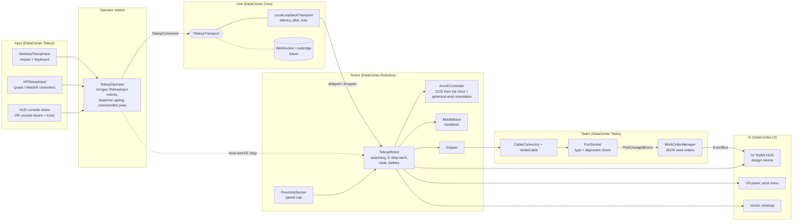

# Data Center Teleoperation Simulator

Teleoperate mobile manipulators stationed around a data center and complete cabling work orders:
pick up a connector, route the cable, and seat it in the right port. Runs on **Meta Quest**
(OpenXR, standalone) and in the **browser** (Unity WebGL + WebXR: mouse and keyboard on desktop,
immersive mode in the Quest browser).

It lives alongside the Da Vinci surgical robot project in this repository and does not touch it:
own scene, own assemblies, own build path.

| | |
|---|---|
| Scene | `Assets/DataCenter/Scenes/DataCenter.unity` |
| Regenerate the scene | **Tools > Data Center > Build Scene** |
| Code | `Assets/DataCenter/Scripts` (runtime), `Assets/DataCenter/Editor` (builders) |
| Tests | `Assets/DataCenter/Tests` (EditMode and PlayMode) |
| Unity | 6000.4.0f1, URP 17.4, XR Interaction Toolkit 3.3, OpenXR 1.15, WebXR Export 0.25 |

---

## Run it

### In the Editor with a Quest (Link / Air Link)

1. Open `Assets/DataCenter/Scenes/DataCenter.unity`.
2. Put the headset on with Quest Link active, then press **Play**. The scene detects the headset
   and switches from the desktop camera to the XR rig on its own.
3. Without a headset, Play gives the desktop operator view with the full HUD.

### On the Quest (standalone APK)

**Tools > Data Center > Platforms > Build Quest APK** writes `Builds/Quest/DataCenterTeleop.apk`.
Install with:

```bash
adb install -r "Builds/Quest/DataCenterTeleop.apk"
```

The APK installs as **DC Teleop** (`com.zrmap.dcteleop`), separately from the Da Vinci app. The
build sets that name and id only for its own duration and restores the project's afterwards.

### In the browser

**Tools > Data Center > Platforms > Build WebGL (WebXR)** writes `Builds/WebGL`. Serve it with a
server that sends `Content-Encoding: br` for the `.br` files (the build is Brotli compressed with
no decompression fallback), over HTTPS or `localhost` (WebXR requires a secure context). In the
Quest browser, open the page and press **Enter VR**.

Neither build edits the project's Build Settings: they pass the data center scene to the build
directly, so the Da Vinci build is unchanged.

---

## Controls

### Desktop (and the web page outside VR)

| Input | Action |
|---|---|
| **Hold Space** | Deadman. Nothing moves without it. |
| Drag the cyan handle | Move the tool in the camera plane (scroll while dragging: depth) |
| Arrows, R / F | Nudge the tool relative to the robot (Shift: fine) |
| Q / E, Z / X | Wrist roll, wrist pitch |
| G | Gripper open / close |
| W A S D | Drive the base |
| Right-click floor, or Space + click minimap | Navigate there |
| Right-drag, scroll | Orbit and zoom the camera |
| 1 - 4, click a robot card or minimap dot | Switch robot |
| Tab | Direct / Console mode |
| H | Home the arm |
| Backspace / Shift + Backspace | E-Stop / reset (reset refused while the deadman is held) |

### Quest controllers

| Input | Action |
|---|---|
| **Either grip** | Deadman. Gripping the handle at the gripper also grabs it: one squeeze enables and steers. |
| Right trigger | Close the gripper while held |
| Left stick | Drive the base |
| Right stick | Wrist roll and pitch |
| Y | E-Stop. **Hold X** for one second to reset. |
| A | Home the arm |
| Left-wrist menu | Robots, mode, link preset, tutorial, E-Stop reset |
| Red pedestal beside you | E-Stop |
| Console stand (Console mode) | Left lever: base. Right lever: tool. Knob: wrist roll. |

### Tutorial

Press **TUTORIAL** in the top bar or on the wrist menu. Sixty seconds in the Staging training
bay: hold the deadman, move the arm, pick up a cable, seat it in training port 1, hit the E-Stop,
reset it. Each step completes on what the robot actually does.

---

## Architecture



**Design points**

- **Commands are plain, serializable messages** (`TeleopCommand`), in the robot's base frame, sent
  through `ITeleopTransport`. The loopback transport simulates latency, jitter and loss; a
  WebSocket or rosbridge transport can replace it without touching input, robots or UI.
- **Commands are state, not events.** Every update repeats the full arm target, drive and
  gripper value, so a lost packet costs smoothness, not correctness.
- **Safety is enforced on the robot**, not the operator station: deadman gating, a 300 ms watchdog
  that stops a robot cleared to move when commands stop, a latching E-Stop that refuses to reset
  while the deadman is held, and a speed cap near equipment. The E-Stop bypasses the simulated
  network, as a hard-wired E-Stop would.
- **IK is the Da Vinci solver, generalized.** `CcdSolver` and `RevoluteJoint` are ported from the
  surgical project (the originals are untouched). The Da Vinci arm solved in two priorities split at
  the remote centre of motion; this arm uses the same split at its spherical wrist: the first three
  joints place the wrist centre, the last three orient the tool, which makes the split exact.
- **Predictive display.** A translucent ghost gripper shows the commanded pose; the gap to the real
  gripper is the link latency made visible.
- **Data in ScriptableObjects and JSON**: robot specs, port types and per-section work orders.
- **No scene search at runtime.** Robots and ports register themselves; systems talk through C#
  events and a small typed event bus.

---

## The facility

A 40 m x 25 m hall with raised floor, hot-aisle containment, overhead fiber ducts and wire
baskets, and blinking server LEDs drawn by a GPU shader (no lights).

| Section | Equipment | Work |
|---|---|---|
| **A** Server Hall | 80 racks in 8 rows; rack A-R03 has a live RJ45 patch panel (U38) and top-of-rack switch (U40) | WO-A-001, WO-A-002 |
| **B** Network Core / MDF | Core chassis, ODF frames, LC fiber panel and line card | WO-B-001 |
| **C** Power Room | UPS and battery line-up, floor PDUs, rack PDU (C13) and server PSU inlets | WO-C-001 |
| **D** Staging / Loading Dock | Pallet racking, spools, pallets, charging pads, loading door, training bay, and the supplied FBX as an integration bench | Tutorial |

Each section has its own robot (Atlas, Borealis, Cobalt, Dash) with a cart of cables, including
deliberately wrong-type leads that the ports reject.

---

## Performance

Budget: 72 fps on Quest 2/3, at most about 150k visible triangles. Measures taken: GPU-blinking
LEDs, LOD groups on racks and on the supplied model, baked occlusion culling, a trimmed shadow
pass, SRP Batcher, an unlit vector minimap (no second camera), and a wrist camera rendered by hand
at 10 fps and 256x160 on Quest.

Render statistics for one eye at Quest 3 resolution, from `PerformanceBenchmark` (PlayMode test,
report in `Logs/Performance/render-stats.md`):

| View (eye height, occlusion on) | Triangles | SetPass | Shadow casters |
|---|---:|---:|---:|
| A operator, cold aisle | 10,323 | 17 | 224 |
| A down the aisle | 12,986 | 17 | 201 |
| Corridor, along the whole hall | 14,635 (39,609 without occlusion) | 14 | 331 |
| B operator | 12,000 | 15 | 196 |
| C operator | 13,570 | 14 | 412 |
| D training bay | 16,160 | 17 | 448 |
| D right at the supplied model (its full LOD) | 79,435 | 6 | 64 |
| Overview from a corner | 16,651 | 22 | 57 |

Before the shadow pass was trimmed, the view at the supplied model was 232k triangles; drawing
its 134k-triangle mesh into the shadow map as well was most of that. Scripts cost about 0.15 ms a
frame in total and allocate under 2 KB a frame (mostly HUD text at its 10 Hz refresh).

Builds: Quest APK 74.3 MB (IL2CPP, ARM64, Vulkan, OpenXR); WebGL 16.7 MB on disk, Brotli.

**Measured on a Quest 3** (standalone APK, Section A operator view, from `adb logcat -s VrApi`):

| Metric | Value |
|---|---|
| Frame rate | **72 / 72 fps** sustained, 0 tears, stale frames under 1 per second |
| GPU time per frame | **7.6 ms** of the 13.9 ms budget at 72 Hz (GPU at 63%) |
| CPU and GPU clock levels | 2 / 2 (headroom left for higher levels) |
| APK size | 74.3 MB |

To capture the same numbers on your device:

```bash
adb logcat -s VrApi
```

The VrApi line printed once a second includes `FPS=`, GPU and CPU levels and stale-frame counts.

or use OVR Metrics Tool's overlay.

---

## Known limitations

- The supplied data center FBX is 134k triangles; it is LOD'd (full model within about 4 m on
  Quest, racks without cabling to about 25 m, boxes beyond) and casts no shadow, but standing right
  at it is the heaviest view in the scene.
- Lighting is one realtime directional light plus ambient. Lightmaps were not baked: the procedural
  meshes are Unity primitives without non-overlapping lightmap UVs, and lightmaps would add several
  MB to the web download.
- Cables are visual Verlet ropes; they do not collide with equipment.
- Connectors snap square into the gripper when picked up, as V-groove fingers would; insertion
  then depends only on the wrist and position.
- The quadruped for Section D was not built.
- The APK (74 MB) still carries the multiplayer template's packages and the AI Inference
  package's compute shaders, which every Android build of this project includes.

---

## Demo script (60 to 90 seconds)

1. **(0:00) Overview.** Start on Atlas in the Server Hall. Point out the HUD: fleet on the left,
   work order on the right, link stats and FPS on top, minimap bottom right.
2. **(0:10) Deadman.** Drag the handle without Space: nothing moves. Hold Space: the banner turns
   green and the arm follows, with the ghost gripper leading the real one.
3. **(0:20) Pick and insert.** Lower onto a blue RJ45 plug, G to grip, carry it to the blinking
   cyan port on the patch panel. The proximity pill goes yellow then red and the speed cap kicks
   in. Release: the LED goes amber, then green, with the link-up chime.
4. **(0:35) Wrong connector.** Pick the yellow LC fiber lead and offer it to an RJ45 port: red flash,
   buzz, "Rejected" toast, error count goes up.
5. **(0:45) Bad network.** Open LINK, choose Satellite. Move the handle: the ghost races ahead and
   the gap readout climbs. Release Space mid-move: the robot holds.
6. **(0:55) E-Stop.** Hit the big red button. Everything freezes; the banner reads EMERGENCY STOP
   LATCHED. Try to reset while holding Space: refused. Release, reset.
7. **(1:05) Fleet.** Press 3 or click Cobalt on the minimap: the camera flies to the Power Room and
   the work order panel switches to the C13 job.
8. **(1:15) VR.** Put on the Quest: same robot, grab the handle with the grip, wrist menu on the
   left hand, E-Stop pedestal at your side.

---

## Tests

```bash
unity test "/Volumes/Zaid/DaVinci/DaVinci copy" --mode EditMode --filter DataCenter
```

```bash
unity test "/Volumes/Zaid/DaVinci/DaVinci copy" --mode PlayMode --filter DataCenter
```

EditMode covers the simulated link (latency, reordering under jitter, loss rate, JSON round trip).
PlayMode drives the real scene through the operator: a scripted robot completes WO-A-001 end to end,
and the deadman, E-Stop latch and reset rule, watchdog, wrong-type rejection, proximity speed cap,
robot hand-over and tutorial start are each checked.
